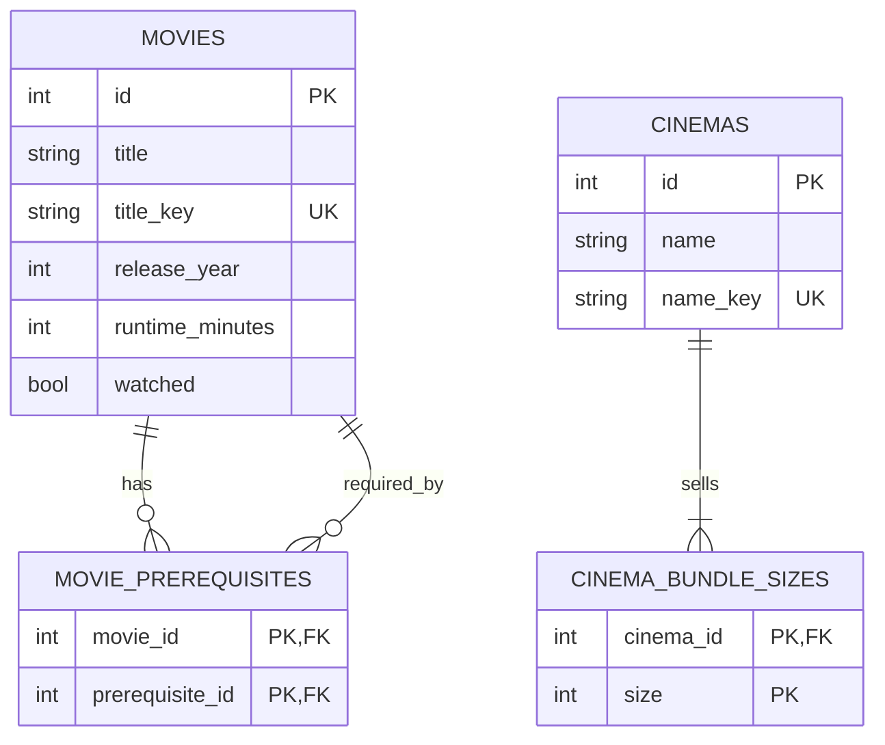

# Doomsday Ready

Doomsday Ready helps you decide what to rewatch before an MCU release and find the fewest seat bundles that fit your group exactly on opening night. The frontend uses React. Express serves the JSON API, and SQLite stores movies, prerequisites, cinemas, and bundle sizes.

## Run locally

Use Node.js 22.13 or later in the 22.x series, or Node.js 24 or later.

```sh
npm ci
npm run dev
```

Open [localhost:3000](http://localhost:3000) once the dev server is running. To serve the production build, run `npm run build` followed by `npm start`.

If you use Docker, this command builds the app and starts it with a volume for the database.

```sh
docker compose up --build
```

Locally, SQLite saves data to `data/doomsday.sqlite`. Docker stores the database in the `app-data` volume. Set `DATABASE_PATH` to use a different file or `PORT` to listen on a different port. The app loads demo data when both the movies and cinemas tables are empty. Set `SEED_DEMO=0` to skip that step.

## Try the assessment examples

- **Rewatch plan** starts with Avengers: Doomsday and shows the seven movies to watch first, in order. Tick Iron Man to see your progress and remaining watch time change. The tick also appears in Movies. Pick Thor: Ragnarok to see an empty plan.
- In **Movies**, you can add a movie, change what comes before it, or mark it as watched. Try making Avengers: Endgame a prerequisite of Iron Man. The API rejects the whole edit with `409 CIRCULAR_DEPENDENCY`.
- In **Booking**, try 6 seats at Quantum Cinema for two 3-seat bundles, or 11 at Starlight Theatre for one 5-seat and three 2-seat bundles. For 44 at Cosmic Multiplex, expect one 20-seat bundle, two 9-seat bundles, and one 6-seat bundle. Midtown Picture House shows "Not possible" for a group of 7.

## API

All paths start with `/api`. Successful POST requests return `201`. The response body for an error looks like `{"error":{"code":"...","message":"..."}}`.

| Method | Path | Request or response |
| --- | --- | --- |
| GET | `/movies` | Array of movies |
| POST | `/movies` | Send `title`, `releaseYear`, `runtimeMinutes`, and optionally `watched` and `prerequisiteIds` |
| PATCH | `/movies/:id` | Send any movie fields to change. `prerequisiteIds: []` clears the list |
| GET | `/movies/:id/rewatch-order` | `targetId`, `movies`, `watchedCount`, `totalMovies`, `unwatchedRuntimeMinutes` |
| GET | `/cinemas` | Array of cinemas |
| POST | `/cinemas` | Send `name` and `bundleSizes` |
| GET | `/cinemas/:id/booking?groupSize=6` | `cinemaId`, `groupSize`, `possible`, `totalBundles`, `bundles` |

The API assigns integer IDs to movies and cinemas. A movie response includes its ID and the submitted fields. A cinema response includes its ID, name, and bundle sizes. Each bundle in a quote has a `size` and `count`. If there's no exact match, the quote returns `200` with `possible: false`, `totalBundles: null`, and `bundles: []`. Missing resources return `404`, invalid input returns `400`, and duplicate titles or cinema names return `409`.

## Data model



## Implementation choices

- The brief lists release year and runtime together. I applied the 1-300 range to runtime in minutes and allowed positive calendar years up to 9999. The sample prerequisites come from the assessment. Avengers: Doomsday has a placeholder runtime.
- The app trims movie titles and cinema names, normalizes them to Unicode NFC, and ignores case when checking for duplicates. Movies are unwatched by default. If you list a prerequisite ID more than once, the app keeps one copy. Bundle sizes must be distinct.
- The rewatch planner uses an iterative depth-first traversal. It adds each movie after visiting its prerequisites. Coming across a movie again on the current path signals a cycle, and movies that have already been added are skipped. Traversing the reachable subgraph takes O(V + E) time and O(V) extra space. The store reads the graph in one query and validates and saves movie changes in a single SQLite transaction.
- To quote a booking, the app finds the fewest bundles for each seat total from zero up to the group size. It uses the choices it recorded along the way to work out how many bundles of each size to buy. It considers larger bundles first when breaking ties. This takes O(group size x number of bundle sizes) time and O(group size) space.
- The local app shares watched status across views. Quotes assume an unlimited supply of bundles and cover only the bundles you would need to buy.

## AI use

I used OpenAI Codex to work through the brief, set up the project, and build the API and React views. Codex helped write the rewatch and booking algorithms from scratch in plain JavaScript. I also used it to check the app’s behavior and put together this README and the Docker setup.
